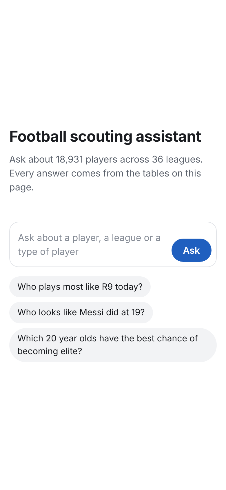
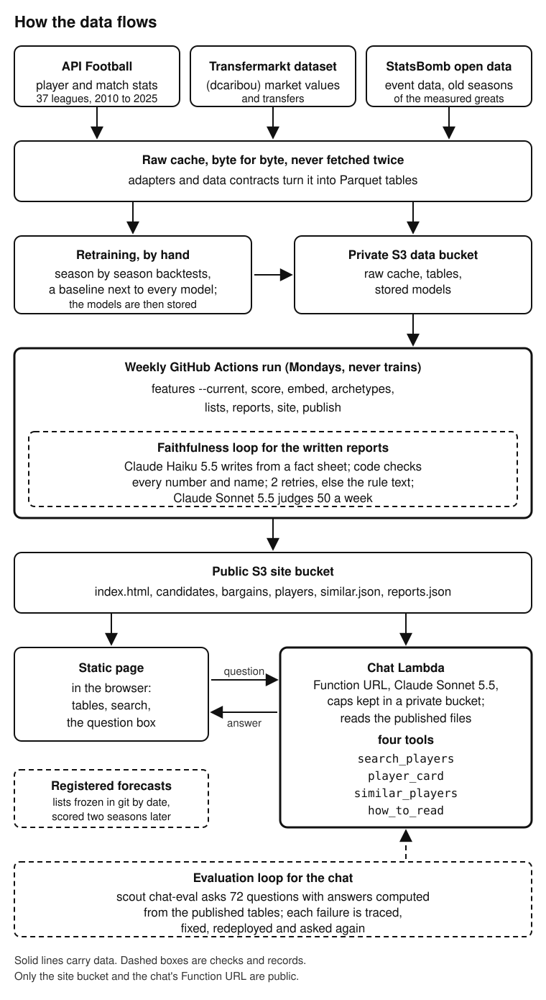

# Football Scouting Assistant

[](https://github.com/ogulcanhayirli/football-scouting-assistant/actions/workflows/ci.yml)
Live page: <http://scout-site-098499087060.s3-website.eu-central-1.amazonaws.com/>

I built this to find footballers who are likely to reach the level of a
Liverpool, Barcelona or Bayern regular before their price says so, and
bargains: good players whose market value is below what their numbers
suggest. It covers 37 leagues (36 of them played in 2025/26 with
minutes in our data) and seasons 2010 to 2025. Once a week a
GitHub Actions run scores the newest season with stored models and
publishes one static page. On the page you ask questions in plain words,
and a chat answers from the published tables only. I am a football fan,
not a professional scout. I made the decisions and reviewed the results;
coding agents wrote the code ([how it was built](docs/HOW_IT_WAS_BUILT.md)).

## A 60 second tour

Open the page and type one of these. Each answer shows the table rows it
was built from under it. The answers below are from 28 October 2026; the
numbers move when the tables do.

1. **"Who plays most like R9 today?"** We hold no data on Ronaldo Nazário,
   so the chat says he is an "archetype from the record, not measured",
   then lists today's centre forwards nearest to that sketch with a
   similarity score. Where one of them has an elite chance, it is given as
   a historical rate ("30% of 142 past players in the same band").
2. **"Is Mbappé a bargain?"** The answer is no, and it says why: he is on
   the value ranking (#550 of the prime list), but his market value (€180m)
   is above the model's fair value (€132m). The word bargain is kept for
   players priced below fair value.
3. **"Tell me about Rodri."** He is on neither list. The chat shows his
   card (ability percentile, league minutes, value against fair value, his
   flags) and the reasons, set in code, why he is on no list ("already
   among the 100 most valuable"; "under half of his team's league
   minutes").



## What makes it honest

* **Chances are realized rates.** Every chance shown is the share of past
  players in the same bucket who made it, from forecasts rebuilt for 2015
  to 2023 and scored two seasons later (last five scored seasons). The top
  elite bucket shows 30%; 27.6% to 32.1% made it in each season 2020 to 2023.
* **Forecasts are registered.** The lists of 21 October 2026 (1,830
  candidates, 1,602 bargains) are frozen in `forecasts/2026-10-21/` under
  the git tag `forecast-2026-10-21`, with both same day revisions recorded
  in the folder. They are scored in 2028, two seasons on.
* **Every model has a baseline in the same table.** Backtests run season by
  season: each test season is predicted by a model trained only on earlier
  seasons, with a gap and a check on the actual dates. Random folds are
  never used. Fair value error: 0.395 against 0.780 for the baseline.
* **Written reports are checked in code against their fact sheet.** Every
  number must be on the sheet as the kind of number its words say, every
  name must be on the sheet, and a report that fails twice is replaced by
  the explanation written by rule. On a judged sample of 50, the check now
  catches 8 of the 9 real errors it used to miss.
* **The chat is evaluated on 72 questions.** 30 with answers computed from
  the tables, 10 the tables cannot answer, 10 attempts to pull the prompt or
  go off topic, and 22 on players, legends and bargains. Latest run (29
  October 2026): 72 of 72, for 0.50 USD.

## Results

From MODELS.md, all 37 leagues, out of sample.

| Model | What it predicts | Metric | Model | Baseline |
|---|---|---|---|---|
| Fair value | log market value | mean absolute error, log units | 0.395 | 0.780 (median of league, position, age band) |
| Big move | joins a top 20 club within 24 months | AUC | 0.928 | 0.803 (group rate) |
| Elite, ranked #101 to #1,000 | enters the 100 most valuable within 2 seasons | AUC | 0.881 | 0.874 (value rank and age band) |
| Elite, same, 23 or under | as above | AUC / top 50 precision | 0.774 / 0.342 | 0.771 / 0.349 |
| Step up | value rank 3 times better, inside the top 500 | AUC | 0.927 | 0.912 (value rank and age band) |
| Riser | ability jumps 20 percentiles and stays | top 50 precision | 0.093 | 0.027 (base rate 0.017) |
| Ability score v2 | (a rating, not a target) | year to year correlation | 0.858 | 0.503 (version 1) |
| Team Elo | club match results | Brier score | 0.161 | 0.180 (home result rate) |
| Bargains, prime top 50 | value rises within 24 months | share | 63.2% | 43.3% (matched peers) |
| Similar players | same player's other season in the top five | hit rate | 19.9% | 13.2% (cosine on style vectors), 0.35% random |
| Greats correction | the same, for StatsBomb seasons of Barcelona | hit rate | 55.1% | 28.6% (uncorrected) |
| Archetypes | drafted traits within 15 points of measured | share | 50% | 28% (a draft of 50 on every trait) |

Two rows are where the model does not win. Among young players the elite
model barely beats value rank plus age, and its top 50 is slightly worse.
Bargains gain value more often than their peers, but they do not move to
stronger clubs more often (39.8% against 41.8%).

## Architecture



One scheduled job, one static page in a public S3 bucket and one Lambda
for the chat. The data bucket is private. The infrastructure is two CDK
stacks in `infra/` (`ScoutSite`, `ScoutChat`). Setup, IAM policy and
secrets are in [docs/DEPLOY.md](docs/DEPLOY.md).

## Cost

About 0.25 to 0.50 USD a month on AWS (mostly storing 8.7 GB of raw
cache), a few cents to 0.25 USD a week of Claude API for the reports
(about 0.75 to 1.40 USD when every report is rewritten), and at most 5 USD
a month for the chat, which is capped in code. GitHub Actions minutes are
free at this size.

## Limits

* **Market values stop at June 2026.** The Transfermarkt dataset has
  published nothing since its 5 September 2026 release, and its last
  valuation is dated 12 June 2026. Until a new value source exists, every
  weekly run republishes the same 2025/26 tables, and the season in
  progress cannot be listed.
* **The refresh moves to the free tier.** The API Football plan that paid
  for the history ends on 7 November 2026. After that I assume the free
  tier (100 requests a day): one pull of every club's squad and transfers
  takes about three weeks, and the weekly update for the free tier is not
  built yet.
* **Young players: the market already knows most of it.** On players of 23
  or under the elite model is about as good as value rank plus age. The
  value is in calibrated odds, risk flags and one treatment of 37 leagues,
  not in beating the market.
* **The ability score is weak for defenders and goalkeepers.** Its
  measures favour goals, passes and shots, so centre backs are rated on
  what a rising player shows, not on defending. The goalkeeper version
  rests on thin measures (passes, fouls drawn, duels), and goalkeeper style
  vectors find the same keeper only 5.7% of the time.
* **Archetypes are illustrative.** The eight legends without data are drafts
  from the historical record that I have not reviewed yet. Drafted the
  same way for six players we can measure, they landed within 15 points on
  half the traits.
* **The greats before 2015/16 are rough.** StatsBomb's open seasons hold
  Barcelona's matches only, so those seasons are measured against
  Barcelona's opponents, with a correction that helps but does not close
  the gap.
* **Cold start.** After the function has been idle, the first answer waits
  5 to 8 seconds while it loads the tables. A ping every 5 minutes keeps it
  warm most of the time.
* **The chat's per visitor cap counts IP addresses.** A visitor whose
  address changes per connection is held only by the daily and monthly
  budget.
* **The page is plain HTTP.** S3 website hosting has no HTTPS, and I left
  CloudFront out. The page holds public tables only.

## How it was built

I wrote the brief and every decision (CLAUDE.md, Decisions), and coding
agents built each numbered prompt against them. Each step shipped with
named tests, and nothing was deployed or paid for until I typed go. The
prompts, what each proved, and what went wrong are in
[docs/HOW_IT_WAS_BUILT.md](docs/HOW_IT_WAS_BUILT.md).

## Run it locally

You need git and [uv](https://docs.astral.sh/uv/).

```bash
git clone https://github.com/ogulcanhayirli/football-scouting-assistant.git
```

```bash
cd football-scouting-assistant
```

```bash
uv sync --all-extras
```

```bash
uv run pytest
```

```bash
uv run scout --help
```

The tests run offline on a synthetic sample in `tests/fixtures/`. Building
the real tables needs the private data bucket or your own API Football key
and a few days of downloads: see [docs/RUNNING.md](docs/RUNNING.md) and
[docs/DEPLOY.md](docs/DEPLOY.md).

## Data credits and licences

* Player and match statistics: **API Football** (api-football.com), used
  under my subscription. Raw responses are cached privately and never
  published.
* Market values and transfers: **transfermarkt-datasets** by dcaribou
  (github.com/dcaribou/transfermarkt-datasets, CC0 1.0), built from
  Transfermarkt (transfermarkt.com).
* Event data of the measured greats: **StatsBomb open data**
  (github.com/statsbomb/open-data), under the StatsBomb Public Data User
  Agreement. Only results computed from it are published, with the
  StatsBomb logo.

The code is under the [MIT licence](LICENSE). The licence covers the code
only, not the data or tables derived from these sources: see
[DATA_LICENSES.md](DATA_LICENSES.md). This is a non commercial portfolio
project.

## More detail

* [MODELS.md](MODELS.md): every model, its backtest and its baseline.
* [FEATURES.md](FEATURES.md): the data dictionary.
* [docs/DECISIONS.md](docs/DECISIONS.md): the design decisions D1 to D25.
* [CLAUDE.md](CLAUDE.md): the working notes every coding session starts from.
* [CONTRIBUTING.md](CONTRIBUTING.md): not taking contributions.
